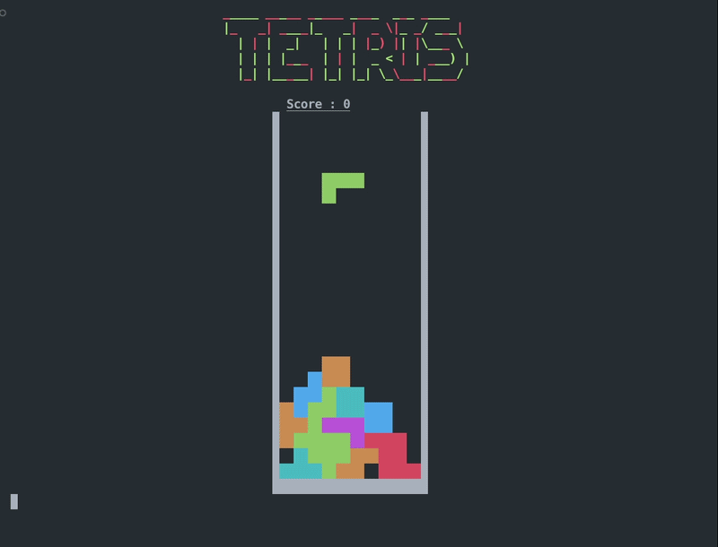

# TUI - TETRIS

Réalisé en 3 jours selon les principes Agile, sans IA.

+ Arthur Calande
+ Gauthier Guignon
+ Guillaume Dussart
+ Issa Le Gall
+ Jeremy Villain--Gourraud
+ Jerome Pardoue
+ Liam Taffin
+ Lilian Roche

## Compilation / Execution  

javac -d bin -cp bin:lib/jline-4.3.1.jar src/tetris/*.java

java -cp bin:lib/jline-4.3.1.jar tetris.Main

## Méthodo 
+ 1 US = 1 Branche
+ Faire ensuite une merge request
+ La personne qui merge n'est jamais celui qui push

# Comment Jouer

+ Se déplacer à gauche    q
+ Se déplacer à droite    d
+ Stoper le jeu           p
+ Rotation d'un bloc      ESPACE
+ Accélérer un bloc       ENTER

